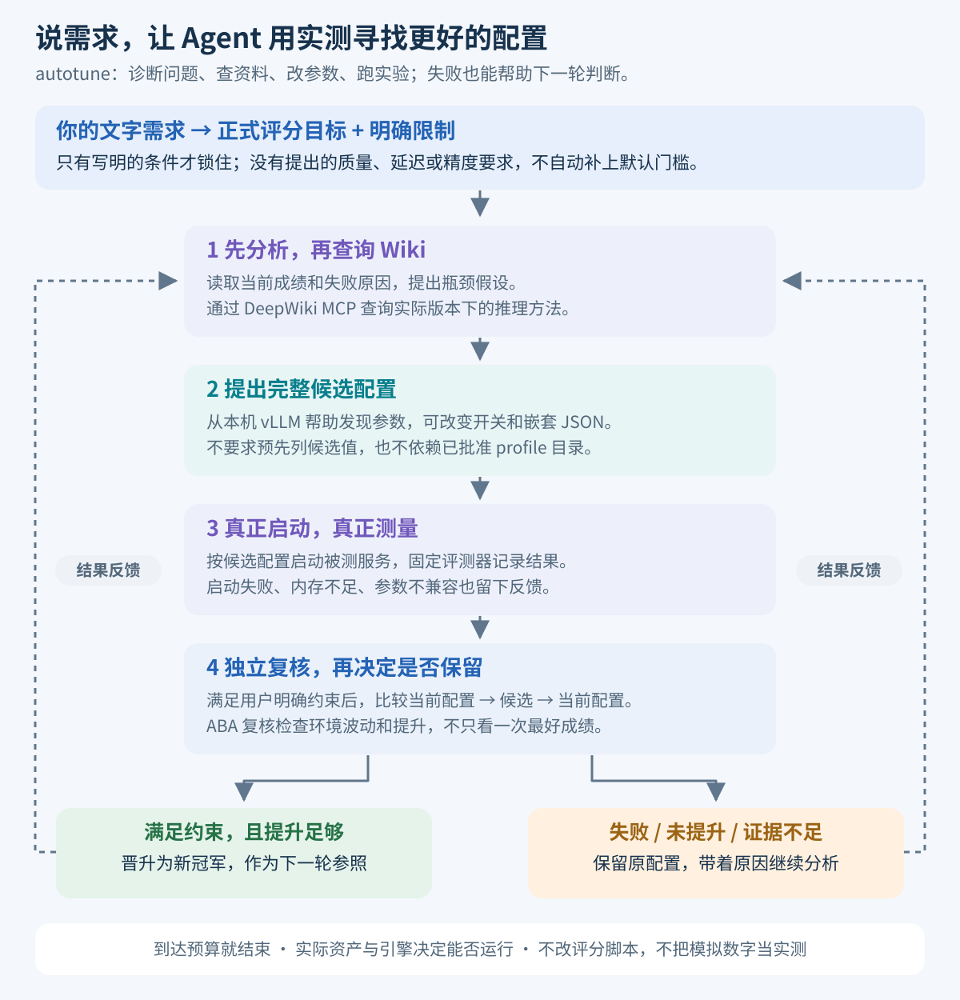

# Ascend Inference RSI Agent

**给昇腾售前 PoC 配一个自动实验助手：先写清客户的及格线，再让 Agent 尝试配置、运行测试，留下经过复测的更好方案。**

例如客户要求“开始回答不能太慢、回答过程中不能卡顿、答案质量要达标”，项目就在这些条件内寻找吞吐更高的配置。吞吐是同一段时间里系统能完成多少工作；吞吐增加但延迟超标的方案，不会成为新冠军。

Python 3.10+ · Linux · 无运行时第三方依赖 · v0.6.0

## 第一次来，从这里开始

| 你想做什么 | 从哪里看 |
|---|---|
| 看懂参数、推理策略，以及这个仓库实际能调什么 | **[图解调优：用人话读懂参数与策略](docs/tuning-explained.md)** |
| 没有昇腾卡也先跑一遍，看到报告 | **[从零复现：演示 → 客户 PoC](docs/quickstart.md)** |
| 已有昇腾服务，准备连接真实模型 API 和客户测试 | [基础测试与部署手册](docs/guide.md) |
| 了解 Agent 的工具、经验、预算和断点恢复 | [RSI Agent 使用指南](docs/rsi.md) |

## 它在做什么

把推理服务想成一家餐厅：**模型**是厨师，**昇腾卡**是厨房，**vLLM-Ascend**负责安排出餐。调参数像调整同时做几桌、每批备多少食材；换策略像复用已准备好的食材、把大订单分段处理。这个仓库负责安排实验和核对结果。



其中有两个不同的模型角色：

- **规划大模型**：通过 API 阅读结果、查资料、建议下一步实验。
- **被测模型**：运行在昇腾卡上，为固定测试请求生成回答；它的速度和质量才是 PoC 成绩。

Agent 的建议要经过程序检查，只能使用操作者开放的策略和参数。资料查询走 DeepWiki MCP，也可经本地 A2A 桥连接；查到一个功能不等于它已获准执行。

## 先跑一次无卡演示

在 Linux 终端进入仓库根目录，确认有 Python 3.10+，执行：

```bash
python3 -m ascend_poc agent-demo --output runs/my-first-demo
python3 -m ascend_poc agent-report --output runs/my-first-demo
```

打开 `runs/my-first-demo/agent_report.md`。演示会让一个合格且更好的候选晋升，再尝试一个延迟超标的候选，展示“更高吞吐也可能不合格”。只有有效晋升后才生成 `champion.json` 和 `champion-contract.json`。

**演示不需要 NPU、vLLM 或 API key。大模型决策、资料和性能数字都由本地替身模拟，不代表真实昇腾成绩或真实大模型的决策能力。** 再跑一次请换新的输出目录。下载仓库、逐条命令解释、报告读法和排障见 [从零复现](docs/quickstart.md)。

## 现在实际能自动调什么

以下对应默认 Agent 使用的 `examples/ascend-workflow.json` 与其客户契约模板：

| 项目 | 当前仓库中的状态 |
|---|---|
| 同时处理多少序列 `max_num_seqs` | 从操作者给定的有限候选值中搜索 |
| 每轮处理多少 token `max_num_batched_tokens` | 从操作者给定的有限候选值中搜索 |
| 推理服务显存预算 `gpu_memory_utilization` | 从操作者给定的有限候选值中搜索 |
| 前缀缓存、关闭分块预填充、eager 模式 | 有 profile 模板，默认关闭且标为未验证；现场验证后才能开放 |
| 量化、推测解码、其他并行布局 | 可研究相关资料；当前没有可直接启用的完整 profile，需工程师接入并验证 |
| 分页管理、连续批处理 | 属于底层 vLLM 引擎机制，本仓库不重新实现它们 |
| 动态 P/D 切换 | `adaptive-plan` 只给出容量预测，不切换在线服务或迁移 KV |

当前基线模板显式开启分块预填充、关闭前缀缓存，固定两卡 TP 和上下文上限；这些是**待现场确认的示例设定，不是所有环境的推荐值**。默认只有 `baseline` profile 可选，它的兼容性说明也必须由工程师用真实记录替换。

默认模板链引用的 `examples/vllm-ascend.json` 使用随机请求做性能测试，**没有答案质量评测，不能直接代表客户质量验收**。[从零复现](docs/quickstart.md#7-三个配置文件各管一件事) 的真实接入路径会改用客户契约模板，由工程师接上实际性能与质量脚本。

只搜索三项是当前模板的范围限制，不代表其他参数没有价值。可以扩展有限参数域或增加经过验证的策略；客户约定的质量、负载与上下文要求必须保持一致。扩展步骤见 [图解调优](docs/tuning-explained.md)。搜索受时间和实验次数限制，不能保证遍历全部组合或找到全局最优。

项目保留包名 `ascend-poc-autotuner`。这里的 **RSI（递归改进）** 指“把通过复测的配置作为下一轮起点，并积累实验经验”。它改进配置和实验选择，不训练模型权重；当前执行器会逐个启动、测试和停止服务，不会把参数实时热切换到生产服务。

## 从演示走向客户 PoC

1. **客户与售前确定规则**：模型、卡数、负载、答案质量、延迟和错误率门槛。
2. **工程师跑通环境**：昇腾软件栈、服务、固定性能测试和质量测试。
3. **配置允许的实验**：填写客户契约、策略目录和 Agent 配置，验证后再启动。
4. **按证据交付**：报告、固定环境与数据标识、复测结果，以及有效冠军配置。

配置检查通过只代表格式与逻辑合格；真实硬件兼容性和客户验收需要实测。[复现指南](docs/quickstart.md) 给出了三份配置的关系、准备命令和每一步的完成标准。

v0.6.0 支持探索失败早停、确认时间预算预检，以及可选的多组独立复测 `aba_ci`。默认 ABA 是“原方案 → 候选 → 原方案”的复测顺序，用来检查是否只是环境波动；统计模式的额外成本和假设见 [预算与验证](docs/guide.md#6-预算硬门槛与独立复测)。

## 完整文档与开发

| 文档 | 内容 |
|---|---|
| [图解调优](docs/tuning-explained.md) | 名词、指标、调大/调小的权衡、策略适用场景与仓库支持范围 |
| [从零复现](docs/quickstart.md) | 下载、无卡演示、读报告、现场接入与排障 |
| [基础手册](docs/guide.md) | 完整配置字段、测试适配器、API、MCP/A2A、验证与交付 |
| [RSI 指南](docs/rsi.md) | 工具决策、冠军晋升、经验、预算、恢复与结果解读 |
| [架构说明](docs/architecture.md) | 控制器、执行器、裁决与影子预测的职责 |
| [参考来源](docs/references.md) | EvolvingInfra、ResearchBoost main 与 RSI-Infra Bench 的方法对应 |
| [开发约定](AGENTS.md) | 开发者与 coding agent 的修改和验证规则 |

```bash
python3 -m unittest discover -s tests -v
python3 -m ascend_poc agent-validate --config examples/inference-rsi.json
```

`workflow` 保留固定策略目录内的一轮调优，`tune` 保留单方案参数搜索。源码在 `ascend_poc/`，模板在 `examples/`；客户配置、密钥、日志和 `runs/` 不应提交到 Git。架构主要参考 EvolvingInfra 的负载感知，Agent 过程参考 ResearchBoost `main`，评测参考其 `bench`。
