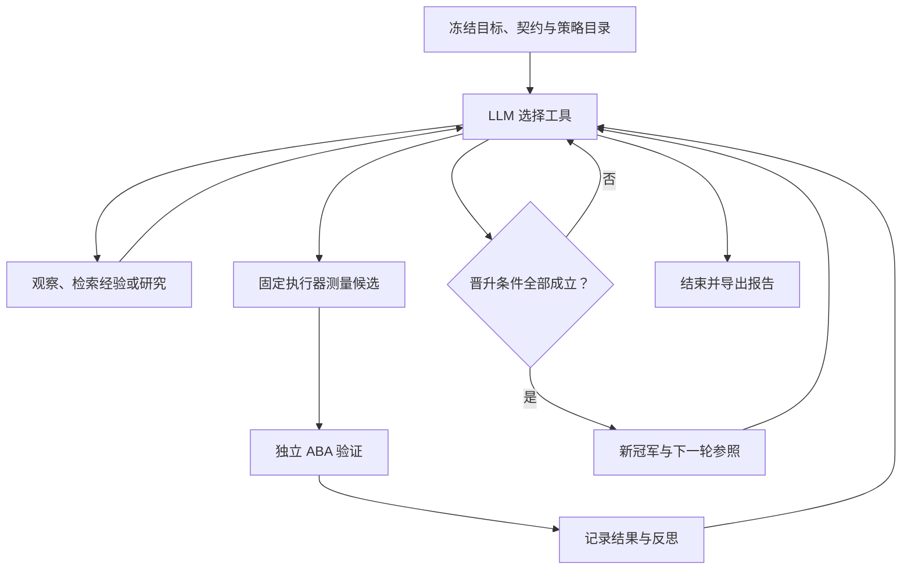

# 架构与执行边界

自然语言开放模式见 [全参数调优](open-tuning.md)，旧受控 Agent 操作见 [RSI 指南](rsi.md)，底层契约与测试接入见 [基础手册](guide.md)，设计依据见 [参考来源](references.md)。

本项目运行在专用 PoC 主机或容器中。规划 LLM 决定下一步工具，控制器检查权限与预算，可信执行器启动推理服务和评测程序，独立验证器裁决结果。规划 LLM、被测推理模型和 DeepWiki 研究服务是不同角色。

## 执行路径

| 路径 | 输入 | 输出 | 对服务的影响 |
|---|---|---|---|
| `autotune` | 原始文字需求、实际资源和评测接线 | 原文约束、能力发现、诊断研究、候选源码复审与独立复核证据 | 在预算内逐个启停服务，测量通过校验与复审的候选，不穷举全部配置 |
| `agent` | 固定目标、客户工作流、经验文件 | 工具记录、实验、冠军谱系及经验 | 通过子工作流按实验启停服务 |
| `workflow` | 客户契约、已验证策略目录 | 研究调优记录、最终确认配置 | 每轮按固定命令启停服务 |
| `ascend_poc.replay` | 固定请求 DAG、服务地址 | 请求/任务延迟、实际 token 用量、遥测 | 发送请求，不管理服务配置 |
| `adaptive-plan` | 校准系数、历史观察窗口 | `hold` 或 `recommend` | 纯影子预测，不操作后端 |

`autotune` 是 v0.7.0 推荐的开放实验入口。`agent` 保留原受控目录和跨任务经验，`workflow` 保留单次固定目录内调优，`tune` 保留单方案搜索。调优 Agent 不代替推理引擎，也不是每个客户请求必经的代理。

## 开放模式

`open_intent.py` 通过规划 API 把自然语言编译为一个主目标、明确指标门槛及带原文引用的参数约束。未写出的条件保持开放；实际设备、模型资产、评测实现与连接地址由 `open_runtime.py` 提供。`open_capabilities.py` 从本机帮助发现引擎参数与布尔别名，支持嵌套 JSON，不预设三参数域。

`open_tuner.py` 先测量起始参照，再按诊断 → MCP 或 A2A 研究 → 提出完整配置 → 查询该候选涉及的文档与实现代码 → LLM 复审 → 启动测量 → 独立复核的顺序循环。`open_research.py` 生成包含嵌套修改、删除和默认值变化的差异，绑定候选、参照及本轮研究证据；控制器校验来源类型与修改覆盖，技术适用性仍由 LLM 综合判断。只有 `run` 决定且没有未解决或截断证据时才测试候选；`reject`、`needs_evidence` 或研究失败均不执行该候选，`on_error: continue` 只允许进入下一轮。

启动失败和不合格指标进入后续分析。新候选不要求旧模式的预验证 profile，但必须通过本轮源码复审；研究文字不能替换执行程序、评分公式或结果文件。起始参照无法测量或不满足明确客户门槛时，首个可行配置须在三次独立启动中全部重复达标，才能建立 `bootstrap` 基线，不声称对不合格参照的加速比。

模型或负载未被客户明确固定时，报告保留完整条件并标明不同运行条件的成绩比较。`open_verification.py` 按客户选择的 `min`／`mean`／`max` 聚合目标判断改进，同时保留逐场景漂移检查与逐重复硬门槛，不额外要求每个场景都加速。各场景目标中位数均为正时使用相对比率；存在零或负值时采用明示尺度的绝对差，避免把错误率 0 当作无效。该模式当前仅支持 ABA，不继承旧 Agent 的跨任务经验、回退工具或区组 CI。

状态与事件链绑定，原始测量、请求／意图／能力快照、候选复审绑定及冠军导出在报告和恢复时重新核验。运行指纹及明确冻结文件仍检查；恢复保留原截止时间和已用预算，未完成操作不会当作成功，也不从中间阶段继续执行同一轮。缺少候选源码复审标记的旧开放任务需新开目录；硬中断产生不完整检查点时可拒绝恢复。

## 旧受控 Agent 与递归改进

LLM 返回一个 `{tool, arguments}` 对象，只有注册动作能执行：观察、回忆、研究、实验、反思、晋升、回退和结束。控制器持有真实状态；LLM 的假设、总结和停止声明不会直接成为性能结论。

每个实验将当前冠军与一个候选作为探索对象，只有候选入围才独立复测；参照胜出时不为参照自身再做无候选晋升用途的 ABA。只有候选获得 `accepted` 且 `improved`，并且实验参照与当前代仍一致，才允许晋升。晋升使新配置成为后续参照，保留客户业务验收不变。

`generation` 单调递增，包括回退。回退恢复上一代配置作为后续参照，不把控制版本倒退，以防旧实验被误用。它不执行生产部署或线上 P/D 操作。各代收益相对各自当轮参照，不能直接拼成相对原始基线的实测收益。

经验文件保存案例、profile 统计与类型明确的参数边缘计数，按版本化测量协议、运行指纹、声明冻结文件的 namespace 隔离。名称、规划 LLM、研究连接和搜索预算可以改变而继续参考兼容经验；测量重复数、门槛、验证协议等仍隔离。历史结果影响候选选择，但不沿用旧成绩、不跳过本次最终确认。反思文本保持与实验关联，不能修改测量事实或裁决规则。`--ignore-memory` 禁止持久经验读写，用于保留本次实验反馈的无历史经验对照；不会放宽恢复指纹。

## 模块职责

下表路径均位于 `ascend_poc/`。

| 模块 | 责任 |
|---|---|
| `cli.py` | 命令参数、入口和退出码 |
| `open_tuner.py` / `open_verification.py` | 开放诊断研究测量闭环、独立复核、基线建立与证据 |
| `open_research.py` | 精确候选差异、MCP/A2A 研究连接、LLM 复审结构及来源绑定 |
| `open_intent.py` / `open_model.py` | 原文约束编译、JSON 规划 API |
| `open_runtime.py` / `open_capabilities.py` | 实际资源与评测接线、CLI 帮助参数发现、受保护选项排除和无 shell 渲染 |
| `rsi.py` | 持久 Agent 工具循环、代际状态、晋升/回退、预算、恢复与报告 |
| `rsi_config.py` | Agent 配置、路径与设置校验 |
| `rsi_planner.py` | 规划 LLM 的工具选择和结构化动作 |
| `rsi_experiment.py` | 当前冠军与候选的实验构造，衔接可信 workflow 验证 |
| `rsi_memory.py` | 按 namespace 保存、检索案例与策略统计 |
| `config.py` / `strategy.py` | 固定客户契约、有限参数域、profile 兼容声明 |
| `workflow.py` | 一次工作流的研究、搜索、测量、最终验证与报告 |
| `budget.py` | 按观测成本估计确认储备、完整组预算预检 |
| `llm.py` / `workflow_planner.py` | 有界模型 API 请求及原工作流提案校验 |
| `deepwiki.py` / `a2a.py` | DeepWiki MCP 与本机 A2A 研究桥 |
| `rsi_research.py` | 当前冠军、近期实验和环境的受限研究上下文 |
| `runner.py` | 固定 argv、端口/健康检查、进程组和测量文件收集 |
| `metrics.py` / `verification.py` / `statistics_ci.py` | 指标归一化、客户门槛、ABA 与独立 block 置信区间裁决 |
| `confirmation.py` | 按保存的独立测量重新核对确认关系与裁决 |
| `replay.py` / `workload.py` / `diagnosis.py` | 请求 DAG、实际 usage、负载摘要与诊断假设 |
| `adaptive.py` | P/D 成本与容量影子预测 |
| `audit.py` / `provenance.py` / `storage.py` | 事件链、输入指纹、完整文件哈希、原子存储和锁 |
| `tuner.py` / `report.py` / `reporting.py` | 单方案调参、历史 workflow/tune 报告兼容 |
| `rsi_demo.py` / `workflow_demo.py` / `demo.py` / `mock.py` | CPU 合成流程与协议测试替身 |

## 旧受控模式的测量与裁决

以下策略目录、早停和 `aba_ci` 规则适用于旧 `workflow`／`agent`；开放模式的约束与聚合目标复核规则见上节。旧客户契约规定场景、模型/硬件约束、性能和质量命令、门槛及目标。策略目录只允许替换已批准的服务设置、参数域、基线参数和条件约束。兼容性 `verified` 是操作者声明，不是模型自行发现的事实。

每次测量使用新目录，顺序为 `before_each_command → warmup_command → command → quality_command`。质量结果不能覆盖性能字段，声明的遥测必须合法且与完成/失败计数一致。

所有场景、每次重复都必须满足硬门槛；缺失指标和执行错误不能补零通过。P99 按每轮检查，不用重复 P99 的平均值冒充合并请求的分位数。目标先按场景取重复中位数，再按契约聚合。

探索可以显式启用硬门槛早停。已执行的某次重复出现失败后，保留部分结果、`infeasible_early` 状态与早停位置；它不能成为完整可行试验或独立确认。参照和确认阶段不早停。执行成本分为固定启动、压测、质量检查及其他开销，供后续预算估计使用。

ABA 对最终配置执行参照 A → 配置 C → 参照 B。参照可以未达到客户 SLO，但测量必须完整有效；任一场景漂移超限产生 `INVALID`。客户达标 `accepted` 与显著提升 `improved` 分别判断。

可选 `aba_ci` 预先固定多组完整 ABA。每场景的统计单元是独立服务启动构成的 block 对数效果，而非同一次服务启动内的重复。单侧 Student t 下界按场景数和预定比较上限分配错误率，并继续要求块内、跨块参照稳定及所有候选重复通过硬门槛。独立性和近似正态性是部署方应检查的假设，不因程序能计算区间就自动成立。详见 [验证协议](guide.md#6-预算硬门槛与独立复测)。

独立运行 `workflow` 时，最终接受即可生成 `best.json`；RSI 晋升进一步要求候选有显著提升及匹配当前参照。因而子实验存在 `best.json` 不意味着 Agent 已产生冠军。

## 状态、预算与审计

开放模式分别限制总墙钟、LLM 调用、研究调用和实验轮数。初次需求编译消耗 LLM 调用；每轮开始前检查是否至少剩余 3 次 LLM 调用与 2 次研究调用，分别供诊断、提案、复审及两次研究使用。测量与 ABA 复核共享原始总截止时间，当前没有旧工作流的确认成本储备、探索早停或逐轮独立时限。

旧 `agent` 的总墙钟、步数、LLM/研究调用及实验次数都有上限。子实验受自己的时限和总剩余时间共同约束。旧 `workflow` 预算以 75% 为探索截止线；启用成本储备后依据 profile 的观测或粗估成本更新探索时限，确认使用全部剩余时间。进场预检跳过估计跑不完的完整确认组；未知或不准确估计仍可能超时。各模式恢复均沿用原始截止时间，不能通过暂停获得新预算。

旧 `agent` 根目录保存状态、输入 manifest、事件链及检查点；每个子实验另存完整 workflow 记录。恢复时校验对应记录，未完成实验不能当作已确认候选。当前环境或声明输入发生变化时不混用旧实验。

完整性优化仅在同一次检查内去重多个 profile 共用的源码、解释器和文件摘要；调用结束前复核身份，下一次检查重新读取。没有跨检查摘要缓存、弱化的 frozen-file 元数据模式或只验日志链尾的替代协议。权威状态仍与 checkpoint 一起提交，预算预留和异常时赢家撤销不能因减少展示报告开销而延迟。

`autotune-report` 总结开放模式，`agent-report` 总结旧 Agent，`report` 总结单个 workflow/tune。`champion.json` 与 `champion-contract.json` 只对应成功晋升或开放模式独立建立基线后的当前配置；初始参照没有自动获得一次独立晋升证明。报告、经验和模型文字都不能单独替代原始实验记录。

## 研究与数据边界

DeepWiki 的官方接口是 MCP。直接查询走 MCP；A2A 路径由本项目的回环代理接收 A2A 0.3.0 同步 JSON-RPC 请求，再转发 MCP。没有公网认证、多租户或任意分布式 Agent 调度。

研究资料与经验文本均视为不可信。LLM 只看到规划所需的受限上下文与结构化摘要，不能从资料获得新的执行权限。原始 prompt、生成内容、完整日志和启动命令不自动发送到研究模型；操作者自行写入的目标、context 和描述仍可能进入请求。

RSI 的研究查询包含当前冠军与近期实验的安全诊断，避免只发送宽泛主题。查询仍受长度、字段和来源限制；研究结果不能改变已冻结的质量门槛或把未验证 profile 标为可运行。

客户命令由操作者提供，以 argv 执行，不经过 shell。规划 API key 从环境读取，并从测量子进程环境移除。客户推理服务需要鉴权时使用独立变量。

## 动态负载与后端边界

回放保留请求依赖、外部等待和记录中的完整 messages；它不执行真实工具，不把新生成文本接回下一轮。实际 token usage 必须来自服务，未观测的 cache 数据保持未知。流式 TPOT 是块时间估计，不等于逐 token ITL；无法观测的多 token 请求不能作为零延迟通过验收。

影子建议器使用成本系数与完整观察窗口比较 P/D 容量。它不自动拟合现场参数、不采集实时样本，也不检查历史窗口距现在的年龄。预测、校准说明或 Agent 身份标签不证明后端支持在线切换。

真正的在线角色切换、在途请求迁移、共享 host KV 和 Agent 感知驱逐，需要实现 Ascend 后端协议、状态版本检查、drain、模糊响应读回、切换后观察与实卡正确性测试。当前服务仍按实验启停。

哈希链用于发现记录不一致，不是防恶意修改的沙箱或数字签名。同一系统账户可以重写代码和整个记录。未声明的大权重目录、外部服务和完整硬件身份也不因存在 manifest 就全部获得验证。

本版递归改进发生在配置、实验选择与经验层。源码/kernel 自动改写、模型权重训练及在线引擎自演进不在当前实现范围内。
