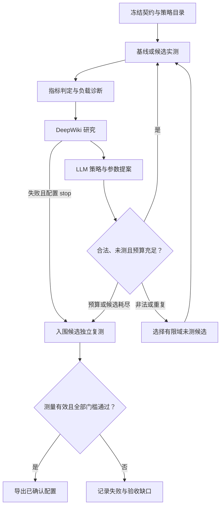

# 架构与执行边界

操作步骤和配置字段见 [完整使用手册](guide.md)；设计来源见 [参考资料](references.md)。

本项目是运行在专用 PoC 主机或容器中的 Python 控制器。它启动操作者声明的推理服务与评测程序，收集实际结果，再调用研究服务和大模型选择下一组配置。被测模型、研究用大模型和 DeepWiki 是三个不同角色。

## 三条执行路径

| 路径 | 输入 | 输出 | 是否改变被测服务 |
|---|---|---|---|
| `workflow` | 冻结客户契约、已验证策略目录、大模型 API | 实验记录、验收报告、已确认配置 | 每轮按固定命令启动和停止服务 |
| `ascend_poc.replay` | 固定请求 DAG、被测服务地址 | 请求/任务延迟、实际 token 用量、遥测 | 发送推理请求，不管理服务配置 |
| `adaptive-plan` | 已校准成本系数、历史观察窗口 | `hold` 或 `recommend` | 无网络或后端操作，仅影子预测 |

`workflow` 是主要调优入口。`tune` 保留单一服务方案内的参数搜索，适合兼容已有契约或固定参数重跑。预测容量、探索得分和最终验收结果分别保存，不能互相代替。

## 调优闭环

所有调用和测量共享总墙钟预算。探索默认使用前 75%，后 25% 预留最终复测；探索提前停止可以提前进入复测。非法提案只会触发已声明有限域内的回退，不会扩张可执行命令或修改客户条件。

研究失败时，`on_error: stop` 停止新增探索，并尝试确认已经实测达标的候选；`continue` 允许缺少研究证据时继续搜索。两种情况都会记录失败。结束状态 `completed` 只表示工作流结束，不表示客户验收通过。

## 模块与数据契约

下表路径均位于 `ascend_poc/`。

| 模块 | 责任 |
|---|---|
| `cli.py` | 命令入口、参数解析、结果路径与退出码 |
| `config.py` / `strategy.py` | 严格 JSON 校验、有限参数域、策略兼容声明与冻结哈希 |
| `workflow.py` | 研究、搜索、预算、复测、恢复与工作流报告 |
| `llm.py` / `workflow_planner.py` | 有界 API 调用、摘要白名单与结构化候选校验 |
| `deepwiki.py` / `a2a.py` | MCP 查询与本地 A2A 研究桥接 |
| `runner.py` | 固定 argv、健康检查、进程组、超时及测量文件收集 |
| `metrics.py` / `verification.py` | 指标归一化、逐次硬门槛与最终 ABA 裁决 |
| `replay.py` / `workload.py` | 固定请求 DAG 回放、实际 usage 和脱敏负载摘要 |
| `diagnosis.py` | 根据失败指标提出有证据边界的诊断假设 |
| `adaptive.py` | 只读 P/D 容量估计、窗口收益与拒绝建议规则 |
| `audit.py` / `provenance.py` / `storage.py` | 事件链、输入指纹、文件散列、原子写入与本地锁 |
| `tuner.py` / `report.py` | 单方案搜索及其报告兼容路径 |
| `reporting.py` | 识别历史记录类型、校验保存快照并重建报告，不访问当前硬件 |
| `demo.py` / `workflow_demo.py` / `mock.py` | CPU 合成流程与本地协议测试替身 |

客户契约定义场景、命令、质量脚本、指标门槛和目标。策略目录只允许替换服务设置、参数域、基线参数和兼容约束；LLM 只能选择已启用且由操作者标记为验证通过的策略。该声明不是自动硬件验证结果。

每次测量使用新目录，依次运行 `before_each_command → warmup_command → command → quality_command`。前两项及质量 hook 可选；客户要求质量时必须接入相应评测和门槛。质量结果不能覆盖性能字段，遥测计数必须与已有完成/失败计数一致。

## 研究服务与数据边界

DeepWiki 使用 MCP。最短路径是控制器直接调用 MCP；配置 A2A 时，请求经过本项目的本地研究代理，再转发到 MCP。桥接实现 A2A 0.3.0 JSON-RPC 同步研究子集，限本机回环监听；不提供完整分布式 Agent 平台。

研究服务和策略 LLM 只接收允许分享的上下文、策略元数据、有限数值摘要和研究证据。原始 prompt、生成内容、执行命令和完整日志不自动发送到研究模型。操作者填写的 `context` 和策略描述也会进入请求，应仅放可分享信息。

检索结果按不可信资料处理。回答中的命令、建议或兼容性声明不能成为执行权限；不在策略目录中的参数仍不可执行。缺失缓存观测保留未知，TTFT 失败仅形成诊断假设，不直接证明 prefill、网络或内存瓶颈。

## 动态负载与影子建议

回放器保留显式依赖和外部等待，依赖本次实际请求完成后才启动后续请求。输入始终是记录中的完整 messages；它不执行真实工具，也不将新生成文本接入后续 prompt。`max_tokens` 是输出上限，不保证不同配置生成相同长度。

请求延迟包括就绪后等待客户端并发槽的时间；任务延迟另外按 `agent_id` 分组。TPOT 根据流式块时间估计，无法观测的多 token 请求会阻止整组导出用于验收的 TPOT，避免将缺测记为零。

影子建议器区分缓存和未缓存输入，并根据固定节点总数比较 P/D 容量。它要求等长完整窗口、足够样本和有限数据；收益不足、缺样或处于冷却期则保持当前分配。输入是历史窗口，尚无实时采样或样本年龄校验。填写校准来源不等于工具验证了校准真实性。

当前执行器仍按轮次启停服务。真正在线 P/D 角色切换、在途请求迁移、共享 host KV 和 Agent 感知驱逐需要额外后端协议及昇腾实卡验证；这些能力没有由影子建议或身份标签自动获得。

## 独立验收与审计

1. 缺失指标、执行失败或任一场景/重复硬门槛失败，均不能验收。P99 按每轮检查，不用多轮平均值冒充合并分位数。
2. 探索候选按目标排序后，独立执行最终重复。推荐 ABA：基线 A → 候选 C → 基线 B，每组使用相同完整场景。
3. ABA 逐场景检查参考漂移；参考失败、测量不完整或漂移超限产生 `INVALID`，不能导出赢家。
4. 候选满足全部客户硬门槛且参考有效时可 `ACCEPTED`。是否超过噪声门槛的提升另存为 `improved`，达标和提速分别裁决。
5. 每轮前后检查运行指纹和声明文件 SHA-256。变化或审计写入失败使实验失效，并撤销最佳配置导出。

`events.jsonl` 以顺序号和前一条记录哈希连接事件；状态检查点的摘要写入该链。恢复时同时核对工作流、环境指纹、声明文件与检查点，不重置原截止时间。候选完成但 ABA 后置基线中断时，恢复重跑整组，而不是把未完成组当作成功。

`best.json` 和 `best-contract.json` 仅从完整性有效、最终确认通过的候选生成。没有可确认候选时，它们不存在；失败记录与其他报告仍然保留。导出配置不会自动部署生产服务。

## 安全模型与扩展

命令由操作者编写，以 argv 执行且不经过 shell；LLM 没有任意 shell 或源码修改权限。API key 来自环境变量，研究模型的 key 会从测量子进程环境移除。本地资源锁只协调使用相同 `resource_id` 的本工具实例，不能替代集群资源管理。

哈希链和文件散列用于发现误改及记录不一致，不是数字签名或沙箱。同一操作系统账户可重写代码和整条链。目录、未声明依赖和硬件身份也不因 `frozen_files` 为空而被完整验证。

新增评测工具可通过固定命令输出 canonical JSON；新增策略先由操作者验证并进入目录；新增在线控制后端应单独实现能力探测、状态版本更新、drain、KV 正确性和回退测试。继续以同一客户契约及独立实测裁决结果。
