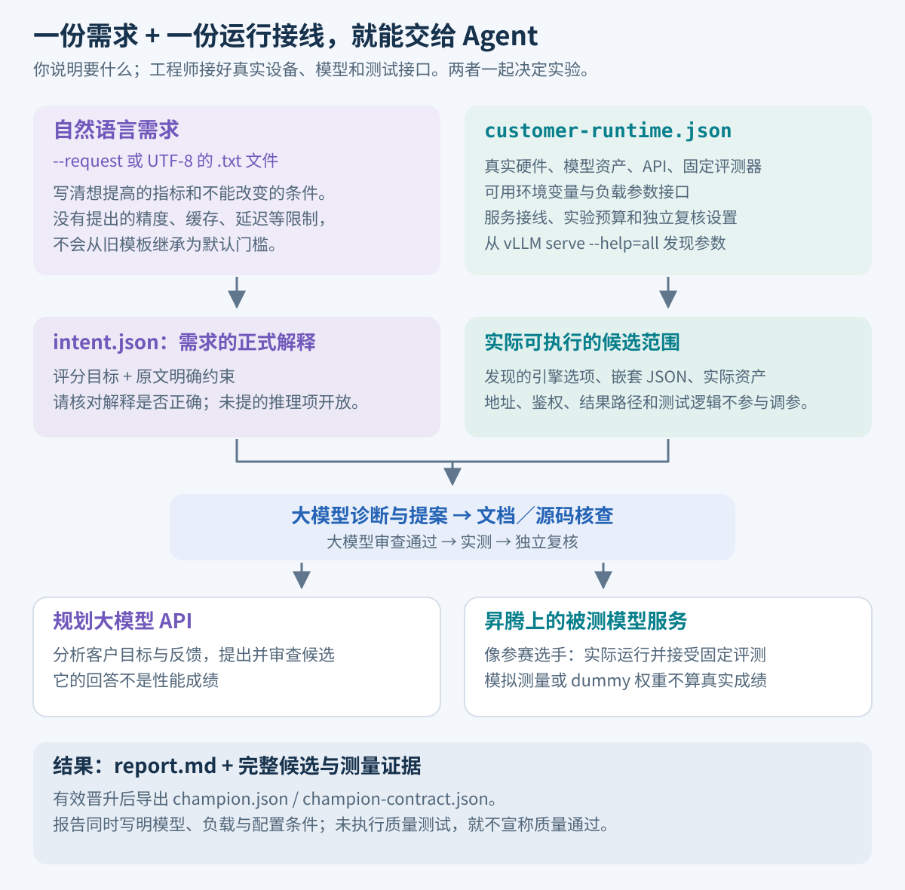

# 自然语言全参数调优

你写“要什么成绩、哪些条件不能变”，Agent 决定“下一步试什么”。这个模式使用 `autotune`，不再要求先把所有候选值写进三参数模板，也不要求每个候选都预先做成已验证的 profile。

从零安装与下载代码见 [第一次使用指南](quickstart.md)。理解参数本身见 [通俗图解](tuning-explained.md)。本文介绍 v0.7.0 新入口；原 `agent/workflow/tune` 的严格有限目录仍按 [原使用手册](guide.md) 工作。

## 1. 用普通话说明需求

可以直接给一段话，也可以把同样的内容放进 UTF-8 文本文件：

```text
设备是两张昇腾 A2。
使用 Qwen 模型。
最在意输出吞吐，目标是最大化 output_tokens_per_second。
P99 首 token 延迟不能超过 2000 ms。
其他推理设置由 Agent 调整。
```

设备和模型名称应能对应到运行接线登记的资源。这里的 Qwen 是示例，换成客户实际模型身份；`A2` 也不能代替工程师确认具体设备与软件版本。

系统把需求编译成正式目标和限制，并保留每条限制对应的原文。**没有写出的条件，不自动从旧模板补成客户要求。**

| 需求写法 | 形成什么规则 | 仍然可以变化的内容 |
|---|---|---|
| “两张 A2” | 与实际登记的设备类型、数量匹配 | 在资源内尝试不同 TP／PP／DP 布局，不自动锁成 TP=2 |
| “使用某个模型家族” | 限制所指模型家族 | 没锁精度时，可尝试已登记且属于该家族的量化资产 |
| “只用模型资产 ID X” | 固定该资产身份 | 其他资产即使属于同一家族，也不能替换 X；引擎设置仍按明确条件调整 |
| “计算 dtype 必须 BF16，KV 也必须 BF16” | 对应的引擎精度锁；资产格式要求另行记录 | 与这些明确精度条件无冲突的缓存、批处理、调度等配置 |
| “P99 TTFT ≤ 2000 ms” | 可测量的延迟及格线 | 达标范围内寻找更高主目标成绩 |
| “只看输出 tokens/s” | 最大化已接入的输出吞吐指标 | 不额外添加质量或延迟门槛；结果不因此获得质量认证 |
| “并发固定 64，输入 2048，输出 512” | 相应已绑定工作负载字段固定 | 服务端的批处理和内存分配仍可搜索 |
| “并发没要求” | 不生成并发锁 | 若评测接线提供此变量，Agent 可以探索不同并发并记录最终条件 |

模型资产的 `precision` 标签只描述登记的权重资产，不证明运行时计算 dtype、KV 精度或所有算子都采用同一格式。“必须 BF16”若没有说明指权重、计算还是 KV，应列为待补歧义；明确的计算／KV 要求应编译成对应的 `engine` 锁，不能只检查资产标签。

原文引用能让人检查解释依据，不能证明大模型永远理解正确。运行前生成的规则、运行后的报告都应与客户原话核对。

如果只说“吞吐和延迟都越好越好”，却没有主次或门槛，二者可能冲突。系统会把无法确定的规则列为待补内容，不暗自发明一组权重。没有明确目标、指标尚未接入、或所需资源无法对应时，也不会用猜测启动客户测试。

## 2. 客户需求与运行接线分开

客户不必填写每个 vLLM 参数，但程序仍需要知道模型放在哪里、怎样启动服务、怎样测量。



| 由谁提供 | 内容 | 作用 |
|---|---|---|
| 客户／售前：自然语言或 text | 设备、模型、关注指标、不能改变的条件 | 定义目的和明确限制 |
| 环境／评测工程师：runtime JSON | 实际设备、可用模型资产、启动程序、评测命令、指标名称、API 接口 | 让实验能够运行并拿到真实结果 |
| Agent：候选配置 | 推理参数、可调环境变量、已接入的工作负载参数和模型选择 | 根据成绩寻找更好的方案 |

`baseline` 是实验起点，**不是把其中所有值锁死**。例如基线写 TP=2，而客户只写总共两张卡，Agent 可以提出资源内其他布局；基线写上下文 8192，而客户没有上下文限制，也不会仅因这个起始值而禁止修改。

运行接线中的实际资产仍然有限：只有两张卡，就不能启动八卡方案；只有一个模型目录，未锁模型也不会凭空产生另一个 checkpoint。要搜索其他量化版本或草稿模型，先把可用资产和所需环境准备好。

## 3. 所有参数具体包括什么

启动时读取目标环境自己的 `vllm serve --help=all`，或者使用从该环境导出的帮助文本。使用 `help_file` 只是离线读取文本，不会认证文本与当前安装的软件栈一致。不能拿互联网上最新版参数表冒充现场已安装版本。CLI 的帮助查询方式见 [vLLM 官方 CLI 文档](https://docs.vllm.ai/en/stable/cli/)；Ascend 的嵌套设置见 [Additional Configuration](https://docs.vllm.ai/projects/ascend/en/latest/user_guide/configuration/additional_config.html)。

| 范围 | Agent 的调整方式 | 必要条件 |
|---|---|---|
| 引擎数值与字符串参数 | 对已发现参数直接提出新值，不限旧模板的枚举列表 | 引擎接受该值，且不违反用户限制 |
| 布尔策略开关 | 使用实际发现的开启／关闭形式 | 不猜测 `--no-` 或 `--disable-` 拼写 |
| 嵌套配置 | 提出 JSON 对象／数组，例如 `additional-config`、`compilation-config`、`speculative-config` | 字段与组合由版本决定，启动反馈验证可行性 |
| 模型与精度变体 | 在 runtime 登记的模型资产中选择 | 尊重用户明确的模型／精度条件 |
| Ascend 调优环境变量 | 改变 `discovery.env_names` 声明的调优变量 | 已接入的真实环境变量；不包含凭据、程序搜索路径或任意代码加载变量 |
| 测试工作负载 | 改变 `workload_parameters` 已绑定的变量 | 用户未锁定；报告标明最终并发、长度等条件 |

示例的 `discovery.env_names` 为空，因此不会自动调整环境变量。需要搜索环境变量时，由接线人员按目标版本登记相应调优变量名；这份列表不等于 Agent 已自动发现整个进程环境。

嵌套引擎配置需要引用已准备好的模型资产时，可以使用 `asset:ASSET_ID`。例如 `speculative-config` 中的 `model` 可填写 `"asset:draft-model"`，其中 `draft-model` 必须是 `runtime.models` 已登记的资产 ID。执行器会解析其实际路径并检查存在；未知 ID 或缺失资产会成为失败反馈，不会自动下载。此引用只解决资产接线，草稿与目标模型能否配合仍需按实际版本和测试结果判断。

这里没有“所有参数都取最大值”的规则。较大的批次可能提高吞吐，也可能拖慢首字；量化可能节省内存，也可能没有加速；复杂策略可能根本不适用于当前模型。Agent 要给出假设，再接受失败或反例。

以下内容属于运行接线或成绩定义，不作为调优技巧：启动哪个程序、执行任意 shell、连接地址与凭据、结果文件、评测实现、评分公式。它们固定，才能确认成绩来自真实测量。参数层面的自由不包含编造指标、读取密钥或让网页内容执行代码。

另外，已知会替换真实模型行为的测试开关，例如 synthetic speculative acceptance 或 force EPLB 的合成路由，不会作为正常模型推理成绩使用。没有质量门槛不等于可以把合成输出冒充真实推理。

控制器不提供自动安装或升级 vLLM-Ascend、下载模型、开发算子，或搭建尚未接入的 P/D 多服务系统的流程。`asset:` 引用会检查登记资产；其他嵌套 JSON 字符串仍可能交给引擎解释，因此不能把这项检查当作对所有后端下载或代码加载行为的全面拦截。需要模型的字段应使用已准备的资产引用，并在源码复审中核对其含义。引擎存在一个相关参数，不代表这个仓库已经实现其全部外部基础设施。

## 4. 先体验一轮无卡实验

在 Linux、Python 3.10+ 的仓库根目录执行：

```bash
python3 -m ascend_poc autotune-demo --output runs/my-open-demo
python3 -m ascend_poc autotune-report --output runs/my-open-demo
```

演示报告位于输出目录的 `report.md`。演示用本地规划／Wiki 替身和合成指标验证流程，不需要 API key、模型权重或昇腾卡。读报告时重点看：从哪条观察得出假设、查了什么、改了什么、测试怎样反馈、为什么保留或放弃候选。

再次体验换新的输出目录。演示数字不能作为对外宣称的昇腾性能，预设模型决策也不能证明真实大模型会找到同样好的配置。

## 5. 准备真实环境

先选一种运行模板；常规吞吐／延迟测试推荐第一种：

| 模板 | 适用情况 |
|---|---|
| [open-vllm-bench.json](../examples/open-vllm-bench.json) | 已接入 `vllm bench serve`，无需另写性能脚本；测真实模型处理随机输入时的吞吐和延迟 |
| [open-runtime.json](../examples/open-runtime.json) | 接入客户自定义跑分程序；需替换 `/opt/customer/run_performance.py` 占位路径 |

采用现成 benchmark 模板：

```bash
cp examples/open-vllm-bench.json customer-runtime.json
cp examples/customer-request.txt customer-request.txt
```

采用自定义适配器时，把第一条命令的源文件换成 `examples/open-runtime.json`。这两种是替代选择，不要连续复制覆盖。

已经编辑过的文件不要再次复制覆盖。用文本编辑器打开这两个文件，先填写以下信息：

| runtime 中的位置 | 要填写什么 |
|---|---|
| `hardware` | 实际设备类型、数量和编号；必须与 `server.env` 的可见设备配置一致 |
| `models` | 可用资产的 ID、路径、模型家族及资产精度标签；模型目录必须确实可用，标签不等于运行精度证明 |
| `server` | 前台服务启动程序、模型占位符、连接选项、健康检查与超时 |
| `baseline` | 一个起始模型、引擎参数、调优环境变量和工作负载值 |
| `discovery` | 现场 CLI 帮助的获取方式、可调环境变量名 |
| `scenarios` | 已跑通的性能／可选质量测试适配器、结果 JSON 与超时 |
| `workload_parameters` | 可由 Agent 调整、且测试命令已经绑定的变量 |
| `metric_names` | 测试适配器真正输出的指标；不能只写一个希望拥有的指标名 |
| `llm` | 规划模型 API 前缀、模型 ID、密钥环境变量名 |
| `research` | `transport=mcp` 或 `a2a`、对应服务地址、查询超时与次数 |
| `budget`、`verification` | 运行时间、实验与 API 次数、重复次数、独立复核设置 |

`hardware` 是接线人员登记的资源事实，不会自动探测或校验整机拓扑；控制器会检查候选的 `TP × PP × DP` 是否超过登记卡数。运行记录自动采集控制器环境中的 `vllm`、`vllm-ascend`、`torch`、`torch-npu` 包版本，但不自动回读服务实际采用的图模式、计算／KV 精度或 CANN／驱动版本。若启动程序进入另一套容器或 Python 环境，需另外核实那里的版本；不能把控制器包版本当作被测服务版本的证明。

相对模型路径与 `discovery.help_file` 相对于 runtime JSON 所在目录解析；命令在 `--workdir` 中运行。`server.command` 必须有且只有一个独立的 `"{model}"` 参数。`workload_parameters` 的键必须与评测命令中的 `{workload.字段名}` 占位符完全对应，且每个候选都要提供这些键。评测输出使用 `{trial_dir}` 指向当前重复测量目录，不能写到其他测量的结果路径。

模板不是客户硬件的兼容性证书。两个模板都没有质量 hook 或默认质量线；自定义模板的性能脚本也需要由现场工程师提供。先确认服务启动、结果归一化及所需指标可读；框架不会替你提供客户专属质量集或评分程序。

现成 benchmark 模板执行的是真实模型推理，输入负载随机生成，**不是无卡 demo 的合成成绩，也不是答案质量测试**。它将并发、输入长度、输出长度和请求数量绑定为可调工作负载；客户明确固定的字段仍会锁定。先用安装版本的 `vllm bench serve --help` 核对选项，说明见 [官方 benchmark CLI](https://docs.vllm.ai/en/stable/cli/bench/serve/)。

模板中的 `num_prompts` 最小值为 1，框架没有自动保证 P99 所需的样本量；小样本的 P99 不能等同于可靠的尾延迟验收。模板还使用 `--request-rate inf`、固定 `--seed 42` 和 20 次预热，且未设置清缓存 hook：同一服务内重复测试可能复用 prefix cache。报告应注明请求数、负载方式及缓存状态；需要固定样本量、有限到达率或冷缓存验收时，应先把相应要求与测量协议明确接入。当前模板不代表持续负载或不同随机种子的验收。

该模板以 `poc-model` 作为固定 API 服务名，并使用独立、固定的 tokenizer 定义测试输入。设置下面两个真实本地路径：

```bash
export MODEL_PATH=/absolute/path/to/model
export BENCHMARK_TOKENIZER_PATH=/absolute/path/to/benchmark-tokenizer
```

如果 tokenizer 随模型一起提供，两者可以指向同一目录；但 `BENCHMARK_TOKENIZER_PATH` 不会随 Agent 选择其他模型资产自动切换。现成模板未声明 `error_rate` 或 `failed`，因为不同版本的 benchmark 输出可能缺少这些字段；缺失不等于零。客户要求错误率时，需要接入能实际报告它的评测，再登记指标。

规划 API 使用兼容 Chat Completions 的接口，`base_url` 填到服务商 API 前缀（通常含 `/v1`），不包含 `/chat/completions`。`json_mode=true` 会发送 JSON response format；若服务商不支持，可设为 `false`，但模型回复仍必须是合法 JSON 对象。开放模式每次模型调用仅尝试一次，`max_retries` 仅为配置兼容保留，不会触发自动重试。

先做纯结构校验，不调用规划 API，也不启动服务：

```bash
python3 -m ascend_poc autotune-validate --runtime customer-runtime.json
```

通过校验不代表资产路径、API 鉴权或硬件兼容性已经通过实测。

API key 放入环境变量。以下命令适用于 Bash，粘贴 key 后按回车，输入不回显：

```bash
read -rsp 'Planner API key: ' POC_LLM_API_KEY
export POC_LLM_API_KEY
```

如果模型资产使用 `{env:MODEL_PATH}`，也需要在当前环境设置真实路径。程序不自动读取 `.env`；不要把密钥写进需求文本、runtime JSON 或 Git。

### 只生成解释与计划

```bash
python3 -m ascend_poc autotune \
  --runtime customer-runtime.json \
  --request-file customer-request.txt \
  --output runs/customer-plan-001 --workdir "$PWD" --plan-only
```

计划阶段会执行配置的能力发现命令（或读取帮助文件），并调用规划 API 编译需求，可能产生 API 费用；它不生成实验候选、不调用 MCP／A2A 研究、不做源码复审，也不启动模型服务进行性能测试。需求无待补项时，仍要求 baseline 模型资产的本地路径可以解析。检查 `intent.json` 和 `report.md` 中原文被解释成哪些正式限制，以及哪些信息尚未解决。成功时状态为 `planned`；有待补条件时为 `needs_input`。`planned` 状态可在原输出目录加 `--resume` 继续执行；总截止时间仍从最初创建任务开始计算。时间已过期时，用新目录开始。

### 开始自动实验

```bash
python3 -m ascend_poc autotune \
  --runtime customer-runtime.json \
  --request-file customer-request.txt \
  --output runs/customer-open-001 --workdir "$PWD"
```

也可以将 `--request-file` 替换成 `--request '你的需求'`，两者选一个。真实运行会使用 NPU、启动与停止配置中的服务，并按供应商规则调用规划 API。服务应使用专用且空闲的端口；启动命令保持前台，由控制器管理进程。

## 6. Agent 怎样按反馈调整

首次先测试运行接线中的 baseline；控制器会按明确客户约束调整起始值。这个初始参照试跑不经过后述的大模型候选源码复审，也不等于已独立验收。后续每轮由大模型围绕客户需求与可检验假设展开：

1. **读结果**：当前配置、客户目标、明确门槛和失败反馈。
2. **大模型分析**：综合观察、参数相互影响和剩余实验机会，说明假设，不由固定规则表替代技术判断。
3. **研究问题**：通过 MCP 或 A2A→MCP 查询 `vllm-project/vllm-ascend` 的相关参数、适用条件和交互。
4. **大模型提候选**：给出完整配置、改变理由、预期影响和已有研究依据；先做结构、明确限制和资源检查。
5. **核查具体修改**：把候选、参考配置、逐项差异和已采集的安装包版本交给研究端，明确要求查阅 vLLM-Ascend 官方文档与实现代码，解释语义、默认值、依赖、冲突、版本和硬件适用性。移除字段和嵌套 JSON 修改也必须覆盖。
6. **大模型复审**：返回 `run / reject / needs_evidence`、理由、已核查改动、文档与代码来源和未解决问题。控制器仅校验证据身份、改动覆盖及候选绑定；不替大模型决定参数。允许实验须引用本轮取得的官方文档与源码位置，并且没有未解决的兼容性疑问。
7. **执行实验**：只有通过复审的原样候选进入真实启动与测试。复审不能偷偷改参数；需要修改就下一轮重新提案并核查。
8. **独立复核**：仍由原有独立测量协议验收。开放模式使用客户指定的 `min / mean / max` 汇总目标判断改善，同时保留逐场景明确门槛、完整性和漂移检查。起始方案不合格时仍按 bootstrap 规则建立首个合格基线。
9. **反馈与下一轮**：保留拒绝、缺证据、实测失败和成功，由大模型继续综合分析。

研究使用 [DeepWiki 对 vLLM-Ascend 的仓库索引](https://deepwiki.com/vllm-project/vllm-ascend)。文档／代码审查支持“这个配置适合进入实验”，不能保证现场启动、输出正确性或性能收益；这些仍需真实测试。仅有仓库首页、参数名或 latest/main 示例，不足以证明实际安装版本兼容。研究回答属于证据，不是可执行指令。

当前执行门槛检查来源 URL 是否在本轮研究回答列出的来源中、是否同时包含官方 Ascend 文档和该仓库实现代码的位置，以及全部改动是否被复审覆盖。控制器不会逐条重新下载链接来独立证明内容、行号或版本适用性；这些技术判断交给大模型，不能将 URL 格式校验表述为代码正确性的形式证明。允许 `run` 时，复审不得留下未解决问题，研究结果也不能被标为截断。

直接 MCP 保持默认接线：

```json
"research": {
  "transport": "mcp",
  "endpoint": "https://mcp.deepwiki.com/mcp",
  "repository": "vllm-project/vllm-ascend",
  "timeout_s": 60,
  "max_calls": 24,
  "on_error": "stop"
}
```

需要 Agent 间研究交接时，复用已有 A2A 0.3 研究桥：

```bash
python3 -m ascend_poc research-agent --port 8766
```

保持研究桥进程运行，在另一个终端设置 `research.transport="a2a"`、`research.endpoint="http://127.0.0.1:8766/a2a"` 后启动调优命令。链路为调优 Agent → A2A 研究桥 → DeepWiki MCP → 文档／源码证据；DeepWiki 本身仍是 MCP 服务。现有桥仅绑定 IPv4 loopback，不增加远程部署或认证能力。若调优器运行在容器中，`127.0.0.1` 必须能访问同一网络命名空间中的研究桥；A2A 桥不会自动跨容器转发。

每个完整候选轮次最多需要 2 次研究调用和 3 次规划模型调用，首次需求编译另需 1 次模型调用；12 轮可预留 `max_calls=24`、`max_llm_calls=37`，仍受原总时间预算限制。已有客户预算不会被自动扩大。预算不足时停止；`on_error=continue` 仅允许下一轮继续尝试研究，不能跳过核查执行无证据候选。

仓库的两个真实运行模板目前仍是 `research.max_calls=12`、`max_llm_calls=32`、`max_experiments=12`，因此研究预算最多支持 6 个完整候选轮次。`max_experiments` 是尝试上限，研究失败、非法提案和复审拒绝也会消耗轮次；它不等于成功启动的候选数。一个通过探索门槛的候选还会增加 3 次服务启动用于 ABA，均计入原墙钟预算。

`state.json` 保存 `source_review`、当前证据 ID 和完整候选／参考配置摘要，报告展示核查结果。恢复和导出时重新检查绑定；旧版本活动任务需使用新目录开始，不能把以前未审查的候选补记为已审查。

需求编译时会把实际负载字段、可调环境变量和已发现 CLI 参数定义提供给大模型。未知字段的明确限制进入 `unresolved`；能力目录不会把 baseline 默认值转成客户限制。

## 7. 怎样解释最高分

目标指标的定义和测量脚本保持固定；客户明确的限制也保持固定。客户未固定而允许探索的条件，需要随成绩一起展示。

| 实验发生了什么 | 可以怎样表述 |
|---|---|
| 同模型、同负载，仅推理设置改变 | 说明相同条件下测得的性能变化及独立复核结果 |
| 并发从 32 改到 128 | 说明更高并发工作点的最高吞吐及其延迟，不能省略并发变化 |
| 输入／输出长度改变 | 同时列出长度；不能称为原长度任务的同口径加速 |
| 换成量化资产 | 列出资产身份、登记精度及请求的计算／KV 设置；这些不是实际生效精度的回读证明。只有接入质量测试并满足要求，才可说明质量达标 |
| 客户没要求质量，测试也没测质量 | 只能说明所选性能指标，质量结论为未验证 |
| 找不到更好候选或预算用尽 | 保留真实停止原因；运行结束不等于成功优化 |

新开放模式当前使用 `aba`；多组 `aba_ci` 仍在旧受控模式中提供，不能把其设置直接搬到新 runtime。ABA 的直观含义是“当前方案 → 候选 → 再测当前方案”，用于检查环境波动。开放模式允许搜索不同条件，但报告必须区分条件变化和同条件加速。所有候选仍需尊重已编译的客户限制。

`repetitions` 与 `final_repetitions` 都是每个场景在同一次服务启动中的重复次数，不是独立重启次数。普通 ABA 的候选 B 只独立启动一次；不能把 `final_repetitions=3` 表述成候选已通过三次独立启动。只有下面的 bootstrap 流程会把同一个新候选分别用于三次启动。每个明确门槛按每次重复检查，目标先对场景内重复取中位数，再按客户选择的 `min / mean / max` 汇总；不会把多个 P99 平均成总体 P99。

### 起始配置不能测量或不合格时

Agent 可以根据反馈继续找合格配置。最初配置无法完成测量，或虽然能跑却违反明确客户门槛时，首个可行候选会用自身做三次独立启动的 ABA；每次启动中的全部重复都必须达标，并通过完整性与稳定性检查。通过后导出 `champion.kind="bootstrap"`，表示**建立了首个合格基线**。不合格旧方案即使分数更高，也不会阻止建立合格基线；此时不宣称相对不合格／失败方案的加速比。之后再相对这份合格基线判断收益晋升。

### 跑分为零或负数时

例如错误率可以等于零，某些客户评分也可能为负数，这些值不应直接当作非法数据。完整测量中所有场景的目标中位数均为正数时，采用汇总目标的相对变化；任一场景出现零或负分时，采用报告中标为 `scaled_absolute_difference` 的判据。此时先在每次独立启动中按客户选择的 `min / mean / max` 汇总目标，再按优化方向计算候选与前后参照均值的差，除以 `max(abs(before), abs(after), 1)`；这里的 `before/after` 是两次参照启动的汇总目标，详见 `objective_comparison`。

这种情况下的抗噪／改进阈值是**标准化差值阈值，不是百分比或加速倍数**，即使配置字段仍名为 `min_relative_improvement`。准确解释保存在 `threshold_interpretation`，每个场景也保留绝对差和比较尺度。

`autotune-report` 根据保存的证据重新生成报告：

```bash
python3 -m ascend_poc autotune-report --output runs/customer-open-001
```

### 保存了哪些文件

| 文件 | 内容 |
|---|---|
| `request.txt` | 原始需求文本 |
| `intent.json` | 正式目标、明确门槛、原文约束、推断和待补内容 |
| `capabilities.json`、`capability-help.txt` | 本次参数发现结果和捕获的原始帮助；离线帮助不等于安装环境认证 |
| `runtime.json` | 实际运行接线快照 |
| `report.md` | 给人阅读的过程、结果和适用条件 |
| `state.json`、`events.jsonl` | 任务状态与事件证据 |
| `trials/` | 每次启动、测试与复核记录 |
| `best_observed.json` | 所有已完成测量中观察到的最佳可行配置，可能是初始参照或复核参照；不等于完成独立晋升 |
| `champion.json`、`champion-contract.json` | 独立复核后的配置与执行契约；`kind=bootstrap` 是首个合格基线，`kind=improvement` 是相对可测参照的改进 |

`autotune` 正常运行退出码为：`0` 有有效冠军（包括已独立建立的 bootstrap 基线）；`2` 没有冠军或需求仍有待补项，后者状态为 `needs_input`；`1` 未被候选反馈处理的配置、API、完整性等异常；捕获到中断时为 `130`。`--plan-only` 成功返回 `0` 只代表计划已生成，不代表性能通过。候选参数非法或启动失败会作为实验反馈，通常继续下一轮，不应解释成该配置成绩为零。原 baseline 即使已经达标，也不会自动成为独立晋升的冠军。

## 8. 恢复与交付

中断后使用同一需求、同一 runtime 和输出目录恢复：

```bash
python3 -m ascend_poc autotune \
  --runtime customer-runtime.json \
  --request-file customer-request.txt \
  --output runs/customer-open-001 --workdir "$PWD" --resume
```

不要在恢复期间悄悄更换目标、输入文本或接线配置。需要改变需求时使用新输出目录；恢复沿用原始截止时间和已花预算，暂停时间也消耗墙钟预算；未完成测量不会算作成功。正常中断保存了完整 checkpoint 时可以继续；硬断电或 `kill -9` 留下半写状态时，完整性检查可能拒绝恢复，不承诺修复所有崩溃中间状态。

给客户交付时一起保留：原始需求、正式规则、实际软硬件与模型资产信息、最终参数和工作负载、研究与实验记录、独立复核证据、可执行接线和报告。只交一张最高分截图，无法解释成绩的适用条件。

## 9. 与旧版模式的区别

| 模式 | 输入与搜索方式 | 使用场景 |
|---|---|---|
| `autotune` | 自然语言／文本 + runtime；发现实际参数，未明确限制的推理设置可搜索 | 需要自主扩大搜索范围的新 PoC |
| `agent` | 三层契约／工作流／Agent 配置；已验证 profile 与有限参数域 | 需要保持旧协议、旧经验与既有任务复现 |
| `workflow` / `tune` | 固定策略目录或单配方的有限参数搜索 | 已确定策略与搜索域的受控比较 |

新开放模式使用本次任务内的成绩反馈，目前没有旧 `agent` 的跨任务经验库、`--ignore-memory` 对照或 `aba_ci`。这些特性不能因为仓库仍保留旧命令就算作新模式已支持。

旧模式的 `verified`、冻结契约和三参数示例仍按原规则运行。选择新模式不会暗中改变旧任务的证据解释。
