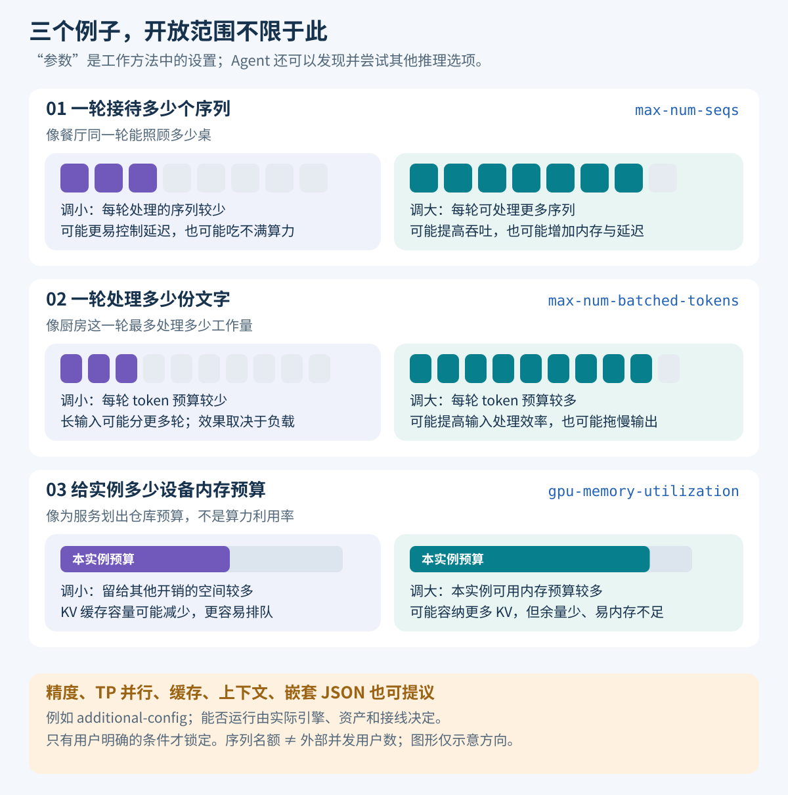
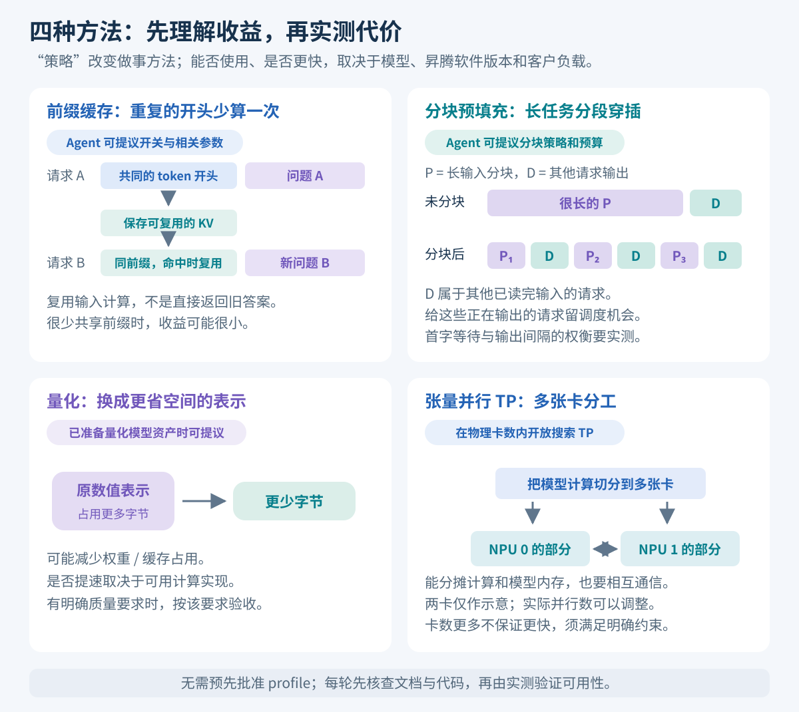

# 把推理调优讲明白：参数、策略与客户成绩

这个仓库帮你回答一个具体问题：**在客户明确的条件下，怎样让推理服务达标，并优化客户指定的指标？**

可以把推理服务想成一家餐厅：模型是厨师掌握的做法，NPU 是厨房设备，请求是订单，vLLM-Ascend 负责安排工作。本仓库的 Agent 像实验负责人：读客户需求、查资料、提出配置、实测、看成绩，再决定下一步。

v0.7.0 推荐使用 **`autotune` 开放模式**：客户明确写出的条件才锁定，未指定的推理配置由 Agent 搜索。旧 `agent/workflow/tune` 的有限参数目录仍可使用。两种入口不要混用，具体操作见 [自然语言全参数调优](open-tuning.md)。

先看本页理解各个“旋钮”；动手路径见 [从零复现](quickstart.md)。开放模式的字段见 [开放调优指南](open-tuning.md)，原受控模式的字段见 [使用手册](guide.md)。

## 1. 一次回答，主要忙哪两件事？

| 词语 | 通俗理解 | 与客户体验的关系 |
|---|---|---|
| Token | 模型处理文字的“小片段”，不固定等于一个字或一个英文单词 | 输入输出长度都应按实际 tokenizer 计数，不能直接拿字符数代替 |
| Prefill，预填充 | 先读题、读材料，算好后续回答要用的信息 | 长文档往往增加读题工作量 |
| Decode，解码 | 根据已读信息，逐步生成回答 | 回答越长，生成阶段通常越重要 |
| KV Cache | 模型计算时保留的“中间笔记” | 省去部分重复计算，但占用卡上的内存；它不是聊天记录数据库 |
| 吞吐量 | 整个厨房每秒能完成多少工作 | 多人同时使用时，整体产能有多大 |
| 延迟 | 某个顾客要等多久 | 产能提高，不代表每位顾客等待更短 |

下面这些指标要分开看。仓库使用的具体字段、单位和统计方式，以客户测试适配器为准。

| 客户说法 | 指标 | 读数方式 |
|---|---|---|
| “点发送后多久开始回答？” | TTFT，首 token 时间 | 越小越好；端到端测量通常包含排队、网络和服务处理 |
| “开始回答后，文字出得快不快？” | TPOT，平均每个后续输出 token 的时间 | 越小越好；它是平均量，不等于每一段输出的停顿 |
| “回答中间会不会突然卡一下？” | ITL，相邻输出之间的间隔 | 关注尾部较大的间隔；不同流式客户端可能按块收包，要核对口径 |
| “完整答案要等多久？” | E2E，单次请求总耗时 | 同条件比较需保持负载与输出长度口径一致；改变长度要另列条件 |
| “忙的时候，慢的那批用户体验怎样？” | P99，例如 `p99_ttft_ms` | 测量样本中约 99% 的值不超过该分位值，不是平均值或最大值 |
| “这组卡一秒能产出多少文字？” | `output_tokens_per_second` | 同一负载下越大越好；输入 token 吞吐和输出 token 吞吐不能混用 |
| “答案是否还合格？” | 客户质量指标，例如 `quality_score` | 必须运行客户认可的评测，快但答错不能算达标 |

例如，客户要求首字 P99 不超过 2 秒、每 token P99 不超过 50 毫秒、质量分不低于 0.95。一个方案即使吞吐更高，只要其中一条不达标，就不能成为合格交付。这里的数字只用于解释；真实门槛由客户确定。

## 2. 参数是旋钮，策略是工作方法

**调参数**是在同一工作方法下改变数量，例如一轮最多安排多少个请求。**换策略**是改变处理方式，例如把长文档分段读、复用相同开头的计算结果。

在新的 `autotune` 模式里，Agent 从目标环境的 CLI 帮助发现可用参数，结合研究资料和成绩提出具体值。它不再局限于预先列出的三个数值，也不用先把每个策略登记为已验证的 profile。候选先通过结构、资源和客户条件检查，再通过 MCP 或 A2A→MCP 核查 vLLM-Ascend 文档与实现代码，由大模型审查具体改动。只有审查允许执行，才启动服务并测试；现场反馈继续检验兼容性和性能。

旧的 `agent/workflow` 仍把预先写好的方法叫作 **profile，策略配方**，并要求其已验证、取值落在有限域内。这是为了保留既有任务的运行方式，不是新模式的限制。

### 先认识三个常见旋钮

| 命令行参数 | 像在调整什么 | 调大可能得到什么 | 代价与检查点 |
|---|---|---|---|
| `--max-num-seqs` | 每轮调度可同时处理的序列数量上限，类似厨房同时安排多少单 | 有足够待处理请求时，可能提高整体产能 | 占用更多 KV 空间，也可能拉长等待；不是客户端并发数，也不保证每轮都满额 |
| `--max-num-batched-tokens` | 每轮可处理的 token 总预算，类似这一轮总共处理多少工作量 | 可给长输入更多处理空间 | 大批量可能干扰正在生成的回答；小批量可能把长文拆成更多轮。要一起看 TTFT、ITL 和吞吐 |
| `--gpu-memory-utilization` | 给本服务安排的设备内存预算比例；名称含 GPU，在 Ascend 环境仍需按后端解释 | 在采用该预算机制的版本中，可能留下更大的 KV 缓存空间 | 其他开销可用的余量变少；它不是“算力利用率”，也不能保证不内存溢出 |

也要看“旋钮是否有机会起作用”：如果压测只有 32 个并发请求，把服务序列上限从 64 改成 128，不会凭空制造更多请求。先确认限制在哪里，再决定调服务端还是在客户允许时探索其他负载工作点。

相关定义见 [vLLM 参数文档](https://docs.vllm.ai/en/stable/configuration/engine_args/)；调度权衡见 [官方调优指南](https://docs.vllm.ai/en/stable/configuration/optimization/)。本文不固定上游默认值，因为版本、设备后端和模型都会影响它们。

### 其他参数同样可以交给 Agent

| 参数 | 通俗含义与权衡 | 新 `autotune` 模式如何处理 |
|---|---|---|
| `--max-model-len` | 一次请求允许的总上下文长度，通常包含输入和输出。大不等于聪明；太小可能装不下请求 | 后端支持且客户未锁上下文要求时可调整；客户明确的请求长度与能力要求仍需满足 |
| `--kv-cache-memory-bytes` | 给“中间笔记”划定固定大小的柜子，直接指定 KV 容量 | 可提出新容量；要注意是否覆盖 `gpu_memory_utilization` 的自动 KV 预算 |
| `--block-size` | 每个 KV 存储块装多少 token。小块可能减少尾部浪费，大块可能减少管理开销 | 可尝试后端接受的大小；不假设图上的任何数字都能在本机用 |
| `--tensor-parallel-size` | 多张卡共同处理同一层计算，还需交换结果 | 可在实际设备与客户资源约束内搜索；“两张卡”不等于必须 TP=2 |
| `--pipeline-parallel-size` | 把不同模型层分到不同卡，接力完成 | 参数存在且运行接线可承载时可尝试；组合可行性仍由实测判断 |
| `--quantization` / `--kv-cache-dtype` | 分别涉及权重／计算格式和中间笔记存储格式 | 客户未锁对应精度时可尝试；资产 `precision` 标签不保证运行 dtype／KV 格式，明确要求需锁相应引擎参数 |
| `--compilation-config` / `--additional-config` | 一整组编译、图模式或 Ascend 专用设置 | 可用嵌套 JSON 提案，不要求把每个内部字段硬编码进三参数列表 |
| `--speculative-config` | 草稿与验证的配置，包括方法和一次起草多少 token | 可结合 Wiki 调整，所需草稿／MTP 资产及后端必须支持 |

“可以提出”不等于“必然可运行、必然更快”。不满足检查或缺少研究证据的候选不会运行；审查通过后仍可能加载失败或内存不足。这些结果都会成为反馈，帮助下一轮调整。程序不把网页内容直接作为 shell 执行。

### 为什么以前只搜三项，现在怎样扩大？

**以前的限制来自示例 `search_space`，新模式取消了这一固定候选列表。** 目标环境实际暴露的推理参数会进入能力目录，Agent 根据目标和反馈选择值得测试的部分；它不会穷举所有可能值，也不能保证找到全局最优。

| 设置来源 | 新模式中的含义 |
|---|---|
| 客户明确说“必须／不得／固定”或给出指标门槛 | 编译成有原文依据的限制，每个候选都必须遵守 |
| runtime 的基线批大小、精度、上下文、并行方式 | 作为实验起点；不自动变成客户锁定条件 |
| 目标 CLI 帮助与实际硬件／模型资产 | 决定哪些提案有执行入口、资源是否存在 |
| 已接入的调优环境变量和工作负载变量 | 未被客户锁定时可改变；记录变化后的实际条件 |
| 启动程序、凭据、连接地址、评分程序和结果路径 | 是实验接线与成绩定义，不是提高分数的可变技巧 |

例如，“使用两张 A2，最大化吞吐”不会自动附加“BF16、上下文 8192、质量 0.95”这些旧模板条件。Agent 可以在已有资产与接口内探索，但最终报告必须说明用了什么模型精度、并发和长度；改变负载后的分数不能省略条件包装成同负载加速。

旧版受控模式仍然使用有限 `search_space`、`baseline`、参数绑定和 profile 兼容性记录，需要按 [原配置手册](guide.md) 修改。新模式的需求写法、能力发现和运行接线见 [开放调优指南](open-tuning.md)。

## 3. 常用推理策略，各自在省什么？

### 前缀缓存：大家读同一段材料，算过的部分尽量复用

假设很多问题都以同一份产品手册开头。前一个请求已经计算过这段开头，后续匹配的请求可以复用相应 KV，少算一段输入。**它主要节省读题阶段，不会直接减少新答案的逐步生成计算。** 如果每个输入都不同、缓存已被淘汰，收益可能很小。

“内容意思相似”不等于可复用：必须满足引擎的 token 前缀、缓存块及其他匹配条件。不能为了展示高命中率，把客户真实请求偷偷替换成重复请求。冷缓存和热缓存测试也应按事先约定执行。见 [Automatic Prefix Caching](https://docs.vllm.ai/en/stable/features/automatic_prefix_caching/)。

### 分块预填充：读长材料时，也给正在回答的人留时间

把一个长输入的读题工作分成小段，与其他已读完输入请求的生成工作交错安排，可以减少长输入对已有回答的干扰。图中的 P 和 D 属于不同请求，不表示同一个请求尚未读完输入就开始回答。块太小，长文可能需要更多轮才读完；块太大，又可能让回答停顿变长。因此 `max_num_batched_tokens` 要配合客户的长短请求比例实测。

它由 chunked prefill 相关配置控制，**不是打开前缀缓存就自动等于打开分块预填充**。关闭分块时，还要按安装版本检查每轮 token 预算与最长上下文的约束。见 [Chunked Prefill](https://docs.vllm.ai/en/stable/configuration/optimization/#chunked-prefill)。

### 量化：用更紧凑的数值表示，换取空间与计算机会

可以类比把某些数字从高精度记录改成较紧凑的记录。W8A8 中，W 指权重、A 指激活；KV 缓存量化则针对中间笔记。它们节省的对象不同，不能把“权重更小”直接推成“整台服务内存减半”。

是否变快，要看模型、卡型、计算内核和瓶颈；转换、读写或额外处理也有成本。Ascend 有自己的受支持格式和工具路径，例如 ModelSlim。不能把 CUDA 平台的 FP8、AWQ 等配置直接当作任意昇腾卡的通用方案。资产的 `precision` 标签不等于计算 dtype 或 KV 精度证明；客户明确这两项时，要分别锁定对应引擎参数。客户要求质量门槛时必须测量并通过；未要求或未测质量时，应明确质量未验证，再报告实际性能。见 [Ascend 量化指南](https://docs.vllm.ai/projects/ascend/en/latest/user_guide/feature_guide/quantization.html)。

### 推测解码：先写草稿，再由目标模型检查

草稿模型、MTP 等方法先提出几个候选 token，再由目标模型验证。被接受得多且额外开销合适时，可能降低生成等待；被拒绝得多，额外工作可能抵消收益。不同方法对模型结构、采样方式和其他策略的支持条件不同。

这不是把草稿不经检查直接交给用户，也不能假设所有配置都保持同样的质量。需要确认受支持的验证方式及与并行、图模式等的组合支持。分析收益时可接入接受率遥测；有客户质量要求时须接入对应评测，不能假定仓库会自动采集这些结果。见 [Ascend 推测解码指南](https://docs.vllm.ai/projects/ascend/en/latest/user_guide/feature_guide/speculative_decoding.html)。

### 多卡并行：分工以后，还要付沟通成本

TP 像几位厨师共同完成一道工序；PP 像不同工位依次接力；DP 像复制多个厨房分流订单。前两者帮助分担单个模型的计算/存储，DP 主要分担不同请求。卡间通信、同步与等待都有成本，卡数翻倍不会保证吞吐翻倍。

TP/PP 的一般概念见 [vLLM 并行指南](https://docs.vllm.ai/en/stable/serving/parallelism_scaling/)；Ascend 的组合限制见 [Pipeline Parallelism](https://docs.vllm.ai/projects/ascend/en/latest/user_guide/feature_guide/pipeline_parallel.html)。客户固定了总卡数后，应在同一资源预算内比较配方。

### 图模式：把常走的计算流程准备好，再重复执行

类似把重复工序编排成固定流程，减少每次安排工作的开销；也可能增加启动准备、内存和形状适配成本。Ascend 有自己的图执行路径，不能把 CUDA Graph 的实现细节直接等同于 NPU。

新模式可针对已发现的图执行参数提出候选；旧受控模式另有 eager 配方样例。eager 不一定更快，基线也不必然采用某一种图模式。有效模式应查启动日志。见 [Ascend Graph Mode](https://docs.vllm.ai/projects/ascend/en/latest/user_guide/feature_guide/graph_mode.html)。

### P/D 分离：读题和生成，安排到不同服务

Prefill 服务负责读题，Decode 服务负责生成，中间需要传递 KV。这样可以分别安排资源，但也引入路由、通信和容量匹配成本。真实部署需要多服务、连接器与网络支持。

本仓库的 `adaptive-plan` 只做容量预测和影子建议，**不执行线上 P/D 切换、迁移请求或动态改卡的角色**。预测结果不能替代端到端客户验收。真实机制见 [Ascend Disaggregated Prefill](https://docs.vllm.ai/projects/ascend/en/latest/developer_guide/Design_Documents/disaggregated_prefill.html)。

### 分页 KV 与连续批处理：它们是引擎的基础机制

分页 KV 像把笔记分装进小格子，再用目录找到它们，减少必须连续摆放造成的浪费。具体实现由引擎和注意力后端决定。连续批处理则允许完成的请求退出、后续请求进入，避免把所有人绑在同一批次等最慢者。

它们不是这个 Agent 另外创造的加速功能。Agent 调整配方和参数，并观察现有引擎的表现。分页原理可看 [vLLM Paged Attention](https://docs.vllm.ai/en/stable/design/paged_attention/)；其中的 GPU kernel 实现说明不能直接当成 Ascend 内核说明。

## 4. 开放调整与真实执行之间还有哪些边界？

| 项目 | 新模式现在怎样做 | 仍由什么决定 |
|---|---|---|
| 引擎参数与策略开关 | 从本机能力目录选择，允许新值和嵌套 JSON；不要求预先写好已验证 profile | 当前版本、模型、设备和组合是否真正可运行 |
| 候选执行许可 | 对具体改动查询官方文档和源码，由大模型审查；证据绑定候选与参照 | 证据完整、覆盖全部改动且无未解决疑问，才允许实测 |
| 调优环境变量 | 从 runtime 接入的调优变量中提出值 | 不提供任意进程环境或凭据改写能力 |
| 工作负载参数 | 用户未锁定且评测脚本已绑定时可搜索 | 记录最终并发、输入输出长度等，分清同条件比较与新工作点 |
| 模型／量化／草稿资产 | 在已准备资源中按用户限制选择 | 不能凭空下载或制造一个不存在的权重文件 |
| 分页 KV、连续批处理 | 使用底层引擎已有机制，调相关配置并测效果 | 本仓库不重新实现推理内核 |
| 动态 P/D、请求迁移 | `adaptive-plan` 仍只输出影子预测 | 真实多服务部署、连接器和迁移协议需另行接入 |

DeepWiki 通过 MCP 提供资料，也可经本地 A2A→MCP 桥访问。新模式先由大模型根据成绩诊断、查询资料并提出候选，再针对候选相对当前参照的全部改动发起新查询，核查版本适用性、参数含义与组合影响。大模型必须引用本轮证据中的官方文档与实现代码、覆盖所有改动且没有未解决疑问，才能允许该候选执行。证据和审查绑定具体候选及参照，改了配置就需重新审查。

文档与源码核查用于决定是否值得执行实验，不证明现场兼容性、性能或客户验收。来源缺失、证据被截断、审查未通过或审查预算不足时，不运行该候选；`on_error=continue` 也不绕过审查。客户明确条件不能被研究文本覆盖。用户提供的起始配置在候选循环前测量，不经过这一步候选审查。

旧 [inference-rsi.json](../examples/inference-rsi.json) → [ascend-workflow.json](../examples/ascend-workflow.json) 仍使用原受控模式，只有 baseline 默认启用；其有限三参数域与手工 `verified` 规则没有改变。旧默认 [vllm-ascend.json](../examples/vllm-ascend.json) 是随机请求性能模板，没有质量评测。不要把旧命令误当新开放模式，或把性能演示当客户质量验收。

## 5. 客户抱怨某项成绩时，先试哪条路？

这张表是排查顺序建议，不能凭单个指标断定瓶颈。先区分负载、排队、模型计算、网络、内存和测试器自身的问题。

| 观察到的现象 | 先确认 | 可设计的受控实验 |
|---|---|---|
| 首字慢，但开始后流畅 | 输入是否很长？是否排队？是否有真实共享前缀？ | 在相同请求下比较 token 预算；有复用证据时再比较前缀缓存 |
| 首字正常，但后续经常停顿 | 长输入是否与生成争资源？卡间通信是否慢？ | 比较分块设置和 token 预算，观察 ITL 尾部；其他策略先核对能力和资产 |
| 整体吞吐低，但延迟余量大 | 压测是否提供足够请求？客户端或网络是否限速？ | 尊重客户固定负载，比较序列上限与 token 预算；客户未固定负载时可另测其他工作点 |
| 内存不足，或频繁重算 | 模型加载占用、KV 使用、并发和其他进程 | 降低每轮负载或调整内存预算；需要量化/多卡时另做质量与资源检查 |
| 开缓存后没有提升 | 前缀是否真匹配？是否预热？是否主要时间花在生成？ | 比较同一输入分布下的冷/热策略，记录缓存命中；不伪造复用负载 |
| 第一次好、之后变差 | 温度、后台负载、缓存、启动准备是否不同？ | 重新跑参照—候选—参照，检查前后参照漂移 |
| 单项都出现过好成绩，但整组不合格 | 是否来自不同参数或不同测试条件？ | 用同一个候选配置跑完整客户场景，逐项过门槛 |

表格用于解释排查思路，不是程序内固定的调参顺序。大模型负责综合分析和选择下一轮实验，Agent 组织执行并记录结果；工程人员负责准备实际环境、资产和测量接口。非技术人员可以用普通话确定目标与限制、阅读报告，并检查成绩附带的条件。

## 6. 怎么知道它真的找到了更好的方案？

假设当前方案 A 每秒输出 100 个 token，新方案 C 是 110。如果机器恰好在 C 测量时更空闲，这 10% 可能不是参数造成的。ABA 会在候选前后各测一次参照：**A → C → A**。前后 A 漂移太大，结果不作为可靠提升。初始配置无法完成测量或不满足明确门槛时，首个可行候选需在自身三次独立启动的全部重复中达标，才能建立 `bootstrap` 合格基线；它没有相对失败或不合格配置的加速比。零分／负分目标使用明示的标准化绝对差判据，见 [成绩解释](open-tuning.md#7-怎样解释最高分)。

开放模式按客户目标的 `min`、`mean` 或 `max` 汇总各场景成绩，再判断总体提升；每个明确门槛和每个场景的参照漂移检查仍须通过。它不会额外要求每个场景都提速。旧受控模式保留原来的最坏场景改进判据。

旧受控 `agent/workflow` 模式可选 `aba_ci`，会重复预先规定的独立启动区组，再检查保守的提升下界。它更花时间；同一次服务启动里重复五次，不等于五次独立启动。统计判据也不能证明未测试的客户场景一定达标。详细条件见 [预算与独立复测](guide.md#6-预算硬门槛与独立复测)。

交付时应能回答以下问题：

1. **哪些条件改变了？** 客户固定项必须一致；开放搜索中模型、精度、负载等变化要列出。只有条件相同时，才能称为同口径加速。
2. **明确要求都过线吗？** 客户写出的延迟、质量等门槛逐项检查；未要求或未测的指标不冒称已验证。
3. **重新测过吗？** 探索阶段好看还不够，候选需要独立确认；早停、跳过或超时不等于通过。
4. **能复现吗？** 留下配置、版本与输入身份、原始结果和报告；不能只保留最好看的数字。

这些是本仓库组织实验的重点。演示运行能让人理解整个过程；真实昇腾性能和客户质量仍必须在客户环境测量。

## 7. 使用图片时，避免几个常见误读

| 容易产生的理解 | 更准确的说法 |
|---|---|
| 参数越大，成绩越好 | 参数改变资源分配；吞吐、延迟、内存可能相互牵制 |
| `gpu-memory-utilization=0.9` 就是算力用了 90% | 它涉及内存预算；算力利用率需另看设备遥测 |
| 前缀缓存与分块预填充是同一个开关 | 前者复用计算，后者安排读题顺序，作用不同 |
| vLLM 的所有开关在昇腾上都一样 | 要核对 vLLM-Ascend 版本、模型、卡型与组合支持 |
| 量化总是最划算，而且不会影响答案 | 要同时测正确性、实际速度、转换及部署成本 |
| 选了策略，框架会自动准备量化模型或草稿模型 | 资产需要预先准备；新模式可以自行探测配置兼容性，但不会制造缺失的模型文件 |
| 查到文档就可以宣布兼容 | 每个候选需先核查官方文档与源码并由大模型审查，再用现场启动、评测与版本记录验证 |

本文按 2026-11-20 查阅的上游资料解释概念。现场先查看已安装版本的 `vllm serve --help`，再选择同版本文档；尤其核对布尔开关、默认值和功能组合。Ascend 总览见 [支持特性矩阵](https://docs.vllm.ai/projects/ascend/en/main/user_guide/support_matrix/supported_features.html)。
